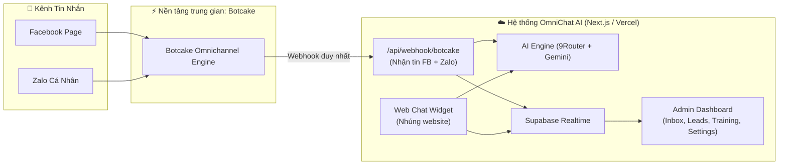

# 🎯 DỰ ÁN VIBECODING 2026 — ĐỀ 04: CHATBOT FAQ & ĐẶT LỊCH TƯ VẤN

> [!IMPORTANT]
> **QUY TẮC CỐT LÕI CẦN GHI NHỚ:**
> 1. **DỰ ÁN ĐỘC LẬP:** Đây là sản phẩm dự thi VibeCoding 2026 (Bảng B - Kinh tế). **TUYỆT ĐỐI KHÔNG liên hệ, KHÔNG gán ghép và KHÔNG dùng dữ liệu của Golden Palace.**
> 2. **KẾT NỐI ĐA KÊNH QUA BOTCAKE:** Toàn bộ kênh **Facebook Page VÀ Zalo cá nhân** được kết nối tập trung qua **Botcake API / Webhook**. Đã loại bỏ hoàn toàn `zca-js`.

---

## 📌 THÔNG TIN DỰ ÁN

| Key | Value |
|-----|-------|
| **Cuộc thi** | VibeCoding 2026 — AI × Mini App |
| **Bảng** | B — Kinh tế |
| **Đề số** | 04 — Chatbot FAQ & Đặt lịch tư vấn |
| **Deadline** | 08/11/2026 |
| **Tên sản phẩm** | **OmniChat AI** |
| **Mô hình ứng dụng** | Doanh nghiệp dịch vụ / Trung tâm đào tạo / Kinh doanh đa kênh |
| **Deploy** | Vercel (Front-end + Serverless API Routes) |
| **Database** | Supabase (PostgreSQL + Realtime) |
| **Repo** | GitHub (phối hợp nhánh `main`, branch cá nhân `chinh/*` và `hien/*`) |

---

## 🏗️ KIẾN TRÚC KẾT NỐI ĐA KÊNH (TINH GỌN)



---

## 👥 PHÂN CHIA CÔNG VIỆC CHÍNH THỨC

```
goldenchat/
├── app/
│   ├── (dashboard)/
│   │   ├── inbox/        <-- Chị Hiền (Frontend Inbox 3 cột, Realtime chat)
│   │   ├── dashboard/    <-- Chị Hiền (Thống kê biểu đồ hiệu suất)
│   │   ├── leads/        <-- Chị Hiền (Quản lý Lead & Lịch hẹn tư vấn)
│   │   ├── training/     <-- Chinh (Quản trị tri thức, Form huấn luyện bot)
│   │   └── settings/     <-- Chinh (Cấu hình hệ thống, giờ trực, kênh kết nối)
│   ├── api/
│   │   ├── ai/           <-- Chị Hiền (Tích hợp AI Engine 9Router + Gemini)
│   │   ├── leads/        <-- Chị Hiền (API bóc tách lead, CRUD lịch hẹn)
│   │   ├── webhook/      <-- Chinh (Webhook duy nhất nhận tin FB + Zalo từ Botcake)
│   │   └── training/     <-- Chinh (API upload Excel, parse tri thức)
│   └── widget/           <-- Chinh (Giao diện Web chat widget nhúng)
├── lib/
│   ├── ai-engine.ts      <-- Chị Hiền (9Router/Gemini wrapper)
│   ├── lead-extractor.ts <-- Chị Hiền (Logic AI bóc tách SĐT/Email/Nhu cầu)
│   └── supabase.ts       <-- Shared (Chinh + Hiền)
└── handoff/              <-- Thư mục Chinh bàn giao cho Chị Hiền
```

### 1. Trần Vân Chinh (Quản trị tri thức + Kênh chat + Cấu hình)
- **Quản trị tri thức (`/training`):**
  - Form nhập ngữ cảnh bot (tên bot, xưng hô, giọng điệu, mục tiêu tư vấn).
  - Upload file Excel FAQ tri thức → parse và nạp vào knowledge base.
  - Kết nối Google Sheet tri thức.
  - Khung "Thử bot" (Simulator trực quan trên màn hình).
- **Kênh chat:**
  - Kết nối Botcake (cho cả Facebook Page & Zalo cá nhân).
  - Viết endpoint Webhook `/api/webhook/botcake` xử lý phân luồng tin nhắn FB & Zalo.
  - Web Widget: Khung chat nhúng trực tiếp trên website.
- **Cấu hình hệ thống (`/settings`):**
  - Thiết lập giờ trực (trong giờ / ngoài giờ) và câu hẹn phản hồi.
  - Cấu hình phạm vi bot cấm trả lời (tự ngắt bot, bắn cảnh báo Telegram).
  - Sổ tay tư vấn (kho câu trả lời mẫu cho nhân viên).
  - Tự động đồng bộ lead cuối ngày vào Google Sheet.
- **Quản lý & Bàn giao:**
  - Khởi tạo GitHub repo, quản trị dữ liệu mẫu, chuẩn bị Video demo 2 phút & README.

### 2. Chị Hiền (Frontend Lead + Tích hợp AI Engine + Lead & Lịch hẹn)
- **Frontend Lead & Giao diện:**
  - Setup khung layout App Router + Tailwind CSS + shadcn/ui.
  - Đảm bảo hiển thị Responsive trên Mobile & Desktop.
  - Màn hình **Hộp thư (Inbox)** 3 cột:
    - Cột 1: Danh sách chat (bộ lọc FB/Zalo/Web, có lịch hẹn, có SĐT).
    - Cột 2: Khung chat 2 chiều, trạng thái AI/Thủ công, nút "Soạn nháp AI".
    - Cột 3: Panel thông tin (Tóm tắt hội thoại, Ghi chú sales, Khách chưa định danh).
  - Màn hình **Dashboard** thống kê tổng quan (số tin nhắn, lead mới, lịch hẹn).
- **Tích hợp AI Engine:**
  - Kết nối 9Router (chính) và Gemini API (dự phòng) qua `lib/ai-engine.ts`.
  - Tính năng AI gợi ý "Soạn nháp" câu trả lời cho nhân viên trước khi gửi.
  - Nút bật/tắt AI tự động; tự ngắt khi có nhân viên thật can thiệp.
- **Lead & Lịch hẹn (`/leads`):**
  - AI bóc tách lead tự động: Họ tên, SĐT, Email, Nhu cầu.
  - Bảng CRM quản lý Lead: lọc trạng thái, tìm kiếm, xuất file.
  - Phân hệ Đặt lịch tư vấn: Form đặt lịch, chọn ngày giờ, trạng thái hẹn.

---

## 🏆 TIÊU CHÍ BẢNG B (100 ĐIỂM)

1. **5 tính năng cốt lõi (30đ):** Chat tập trung ➔ AI phản hồi/nháp ➔ Đặt lịch hẹn ➔ Thu thập Lead ➔ Quản trị tri thức.
2. **Vibe Coding với AI (20đ):** Minh chứng tương tác và ra lệnh cho AI trong quá trình xây dựng.
3. **Hiểu bài toán (15đ):** Giải quyết tình huống thực tế của doanh nghiệp thiếu nhân sự trực chat 24/7.
4. **Nghiệp vụ & Data đầu ra (15đ):** Nội dung tư vấn chuẩn xác, phân định rõ real vs mock data.
5. **UI/UX (10đ):** shadcn/ui, mobile-first, dễ thao tác.
6. **Xử lý lỗi (5đ):** Validate SĐT, ngày giờ lịch hẹn.
7. **Demo & Bàn giao (5đ):** Video 2 phút, README chuẩn, source ZIP sạch.
