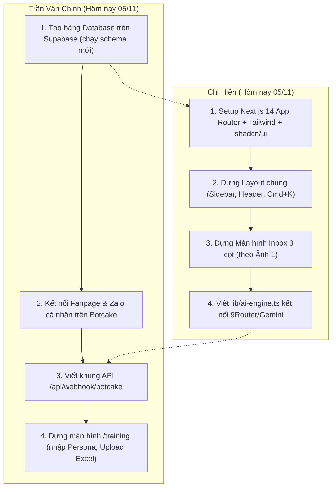

# 🚀 PLAN THỰC THI CHI TIẾT — OMNICHAT AI
## Đề 04: Chatbot FAQ & Đặt Lịch Tư Vấn · Bảng B VibeCoding 2026

Bản kế hoạch này định nghĩa **chính xác từng interface, API contract, luồng dữ liệu** để Chinh và Chị Hiền bắt tay vào code độc lập, ráp nối mượt mà 100% không bị xung đột.

---

## 🏛️ I. CẤU TRÚC CODE & PHÂN QUYỀN SỞ HỮU FILE

```
goldenchat-vibecoding/
├── app/
│   ├── layout.tsx                    <-- [Hiền] App shell, font, providers
│   ├── (dashboard)/
│   │   ├── layout.tsx                <-- [Hiền] Sidebar, Top Header, Cmd+K search
│   │   ├── inbox/page.tsx            <-- [Hiền] Màn hình Hộp thư 3 cột (Ảnh 1)
│   │   ├── leads/page.tsx            <-- [Hiền] Màn hình Phễu & Kanban N1-N5 (Ảnh 3 & 4)
│   │   ├── dashboard/page.tsx        <-- [Hiền] Thống kê biểu đồ tổng quan
│   │   ├── training/page.tsx         <-- [Chinh] Huấn luyện bot & Simulator (Ảnh 2)
│   │   └── settings/page.tsx         <-- [Chinh] Kênh Botcake, Giờ trực, Guardrails
│   ├── api/
│   │   ├── webhook/botcake/route.ts  <-- [Chinh] Nhận webhook tin nhắn FB + Zalo
│   │   ├── training/upload/route.ts  <-- [Chinh] Xử lý upload file Excel FAQ
│   │   ├── ai/chat/route.ts          <-- [Hiền] Endpoint gọi AI phản hồi tự động
│   │   ├── ai/draft/route.ts         <-- [Hiền] Endpoint AI gợi ý soạn nháp
│   │   └── leads/route.ts            <-- [Hiền] CRUD Lead & Cập nhật giai đoạn Kanban
│   └── widget/page.tsx               <-- [Chinh] Khung chat nhúng cho website
├── components/
│   ├── ui/                           <-- [Hiền] shadcn/ui components
│   ├── inbox/                        <-- [Hiền] ChatList, ChatWindow, LeadInfoPanel
│   ├── leads/                        <-- [Hiền] FunnelView, KanbanBoard, LeadCard
│   ├── training/                     <-- [Chinh] PersonaForm, KnowledgeList, Simulator
│   └── settings/                     <-- [Chinh] BotcakeConfig, TelegramAlertForm
├── lib/
│   ├── supabase.ts                   <-- [Chung] Khởi tạo Supabase client & types
│   ├── ai-engine.ts                  <-- [Hiền] Wrapper 9Router + Gemini fallback
│   └── lead-extractor.ts             <-- [Hiền] Logic prompt bóc tách SĐT/Email
└── types/
    └── database.ts                   <-- [Chung] TypeScript types chuẩn
```

---

## 💾 II. CHUẨN HÓA DATA MODELS (SUPABASE TYPES)

Cập nhật trực tiếp theo **4 ảnh giao diện thực tế**, đặc biệt là hệ thống Phễu 6 giai đoạn:

```typescript
// types/database.ts

export type PlatformType = 'facebook' | 'zalo' | 'web';
export type SenderType = 'customer' | 'bot' | 'agent';

// Giai đoạn phễu khách hàng (Khớp 100% Ảnh 3 & 4)
export type LeadStage = 
  | 'N1' // Lead thô (Mới nhận thông tin)
  | 'N2' // Tiềm năng (Đã liên hệ, có nhu cầu)
  | 'N3' // Học thử (Đã hẹn lịch tư vấn 1-1 / học thử)
  | 'N4' // Chính thức (Đã đăng ký / nhập học)
  | 'N5' // Nuôi dưỡng (Chưa chốt, cần chăm sóc thêm)
  | 'N0'; // Đã mất (Không có nhu cầu / sai số)

export interface Conversation {
  id: string;
  platform: PlatformType;
  external_thread_id: string; // ID từ Botcake
  customer_name: string;
  customer_avatar?: string;
  customer_phone?: string;
  is_ai_enabled: boolean;      // Toggle bật/tắt AI từng phiên
  assigned_to?: string;        // Phụ trách (Trần Diệu Thúy, v.v.)
  unread_count: number;
  last_message: string;
  last_message_at: string;
  has_appointment: boolean;
  has_contact_info: boolean;
}

export interface Message {
  id: string;
  conversation_id: string;
  sender_type: SenderType;
  sender_name?: string;
  content: string;
  is_draft?: boolean;
  created_at: string;
}

export interface Lead {
  id: string;
  conversation_id?: string;
  full_name: string;
  phone: string;
  email?: string;
  course_interest?: string;    // Khóa học quan tâm (ENTD01, v.v.)
  stage: LeadStage;            // N1 -> N5, N0
  assigned_to: string;         // Nhân viên phụ trách
  last_touched_at: string;     // Dùng để lọc "Chưa ai chạm quá 7 ngày"
  notes?: string;
  source: PlatformType;
  created_at: string;
}

export interface BookingAppointment {
  id: string;
  lead_id: string;
  customer_name: string;
  phone: string;
  appointment_time: string;
  assigned_staff: string;
  status: 'pending' | 'confirmed' | 'completed' | 'cancelled';
  notes?: string;
}
```

---

## 🔌 III. API CONTRACTS GIỮA CHINH & CHỊ HIỀN

### Contract 1: Webhook Botcake (Chinh xây dựng) ➔ Supabase

* **Endpoint:** `POST /api/webhook/botcake`
* **Nhiệm vụ:** Nhận payload từ Botcake khi có tin nhắn từ FB Page hoặc Zalo cá nhân đổ về.
* **Quy trình xử lý:**
  1. Parse payload: Lấy `platform` (fb/zalo), `sender_id`, `sender_name`, `message_text`.
  2. Tìm hoặc tạo `conversation` trong bảng `conversations`.
  3. Thêm tin nhắn mới vào bảng `messages` (sender: `customer`).
  4. Nếu `conversation.is_ai_enabled === true`:
     - Tự động kích hoạt AI (`lib/ai-engine.ts`) để tạo câu trả lời của Bot.
     - Lưu câu trả lời vào `messages` (sender: `bot`).
     - Gọi ngược API Botcake gửi tin nhắn trả lời khách hàng.

---

### Contract 2: AI Engine Wrapper (Chị Hiền xây dựng trong `lib/ai-engine.ts`)

Chị Hiền cung cấp 3 hàm cốt lõi để cả 2 người sử dụng:

```typescript
// lib/ai-engine.ts

// 1. Bot tự động trả lời (Dùng khi AI bật)
export async function generateBotReply(params: {
  incomingMessage: string;
  chatHistory: Message[];
  knowledgeBase: string; // Context từ bảng knowledge_base
  personaPrompt: string; // Cấu hình từ /training
}): Promise<string>;

// 2. Soạn nháp cho nhân viên (Nút Magic Draft ở Ảnh 1)
export async function generateDraftReply(params: {
  lastCustomerMessage: string;
  chatContext: string;
  knowledgeBase: string;
}): Promise<string>;

// 3. Tự động bóc tách Lead từ tin nhắn
export async function extractLeadFromText(text: string): Promise<{
  phone: string | null;
  email: string | null;
  fullName: string | null;
  demand: string | null;
}>;
```

---

### Contract 3: Màn hình Lead — Chuyển giai đoạn Kanban (Chị Hiền)

* **Thao tác kéo thả trên Kanban:** Khi người dùng kéo thẻ từ `N1` sang `N2` (hoặc N3, N4):
  * Frontend gọi: `PATCH /api/leads`
  * Body: `{ leadId: "uuid", newStage: "N2" }`
  * Database cập nhật `stage = 'N2'` và `last_touched_at = NOW()`.
  * Biểu đồ Phễu tuyển sinh (Funnel Chart bên tab Danh sách) tự động tính toán lại tỷ lệ % chuyển đổi giữa các tầng:
    $$\text{Tỷ lệ chuyển tiếp} = \frac{\text{Số lượng bậc } N_{i+1}}{\text{Số lượng bậc } N_i} \times 100\%$$

---

## ⏱️ IV. THỨ TỰ THỰC THI NGÀY 05/11 (HÔM NAY)

Để tận dụng tối đa thời gian ngày hôm nay:



1. **Buổi sáng (09:45 - 12:00):**
   - **Chinh:** Cập nhật bảng dữ liệu trên Supabase (bổ sung trường `stage` N1-N5). Bắt đầu kết nối Botcake lấy webhook.
   - **Hiền:** Khởi tạo khung mã nguồn Next.js 14, cài Tailwind, shadcn/ui, dựng khung Layout (Sidebar + Header).
2. **Buổi chiều (13:30 - 17:30):**
   - **Chinh:** Viết Webhook Botcake nhận tin nhắn và dựng giao diện `/training` (Huấn luyện bot).
   - **Hiền:** Dựng màn hình `/inbox` 3 cột và viết file `lib/ai-engine.ts` gọi Gemini/9Router.
3. **Buổi tối (19:30 - 21:30):**
   - **Ráp nối đợt 1:** Bắn thử tin nhắn từ Facebook/Zalo qua Botcake ➔ Webhook nhận ➔ Đổ vào giao diện Inbox của chị Hiền ➔ Bấm nút "Soạn nháp AI".
