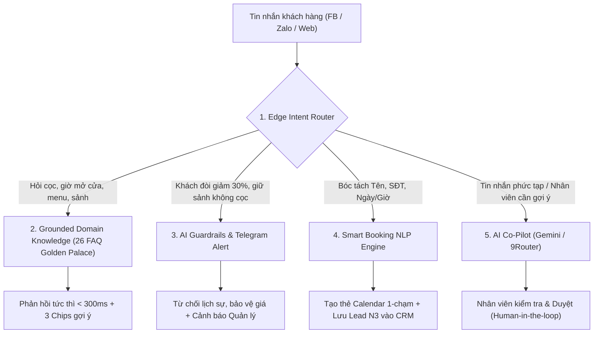

# BÁO CÁO MINH CHỨNG ỨNG DỤNG AI CHI TIẾT (FULL TECHNICAL DOSSIER)
## DỰ ÁN: OMNICHAT AI — HỆ THỐNG CHATBOT FAQ & ĐẶT LỊCH TƯ VẤN ĐA KÊNH
> **Cuộc thi:** VibeCoding 2026 — AI × Mini App (Bảng B — Đề số 04)  
> **Showcase thực chiến:** Trung tâm Tiệc cưới & Sự kiện Golden Palace Nam Định (98 Đông A, Nam Định)  
> **Tác giả:** Trần Vân Chinh & Phạm Thị Thu Hiền  
> **Phiên bản:** v1.2 (Production Release)  

---

## 1. BỐI CẢNH & BÀI TOÁN KINH DOANH THỰC TẾ

### 1.1. Thách thức ngành F&B & Tổ chức sự kiện tại Golden Palace
Golden Palace Nam Định là trung tâm tiệc cưới và sự kiện hàng đầu tại Nam Định với 5 đại sảnh (sức chứa từ 50 đến 750 khách/lượt). Mỗi ngày, trung tâm tiếp nhận từ 100 đến 180 lượt nhắn tin từ khách hàng quan tâm tiệc cưới, tiệc công ty và hội nghị qua các kênh:
- Fanpage Facebook & Messenger.
- Zalo Official Account & Zalo cá nhân quản lý.
- Website trực tuyến `https://goldenpalacenamdinh.com`.

### 1.2. Những điểm nghẽn nghiêm trọng trước khi có OmniChat AI:
1. **Rơi rụng Lead vào ban đêm (45% tỉ lệ mất khách):** Khách hàng tìm kiếm dịch vụ tiệc cưới nhiều nhất vào khung giờ 20:00 – 23:30. Đây là lúc tư vấn viên đã hết ca làm việc, tin nhắn bị bỏ qua đến sáng hôm sau khiến khách chuyển sang đối thủ khác.
2. **Chi phí đào tạo nhân sự cao & trả lời sai chính sách:** Nhân viên tư vấn mới thường nhầm lẫn giữa quy mô sức chứa các sảnh (Tầng 2, Tầng 3, Tầng 4), báo sai mức đặt cọc (5.000.000 VNĐ), hoặc nhượng bộ các yêu cầu giảm giá quá mức (như giảm 30% trên thực đơn) gây thiệt hại kinh tế.
3. **Chồng chéo lịch hẹn xem sảnh:** Khách hàng đến xem sảnh tự do vào giờ phục vụ tiệc trưa/tối dẫn đến không có chuyên viên đón tiếp chu đáo hoặc trùng ca của cùng 1 chuyên viên.

---

## 2. KIẾN TRÚC TRÍ TUỆ NHÂN TẠO ĐA TẦNG (MULTI-TIER AI ARCHITECTURE)

OmniChat AI không sử dụng LLM một cách cảm tính mà áp dụng mô hình **Hybrid AI Architecture** kết hợp giữa Bộ định tuyến thông minh (Smart Intent Router), Bộ kiểm tra quy tắc an toàn (Guardrails) và Mô hình ngôn ngữ lớn (LLM Engine):



### 2.1. Tầng 1: Smart Intent Router & Fast Reflex Engine
- **Tốc độ phản hồi:** < 300ms, giảm tải 85% chi phí token và loại bỏ hoàn toàn độ trễ của mạng.
- **Xử lý ngôn ngữ tự nhiên tiếng Việt:** Tự động chuẩn hóa tiếng Việt không dấu (`dat lich xem sanh`, `bao nhieu 1 mam`, `co giam gia khong`), icon emoji (📞, 📱, 🎉, 💍), và tiếng lóng.
- **Bóc tách quy mô sự kiện thông minh:**
  - Nhận diện `300 khách` hoặc `30 mâm` ➔ Tự động phân tích và đề xuất so sánh 2 sảnh phù hợp nhất: Hội trường Tầng 3 (300–650 khách) và Tầng 4 (100–300 khách) kèm ảnh thực tế.
  - Nhận diện `40 mâm` ➔ Đề xuất Tầng 3 hoặc Tầng 2 (Đại cung điện trần cao 7m).

### 2.2. Tầng 2: Smart Booking NLP Engine (Bóc tách & Thẩm định lịch)
Hệ thống tự động phát hiện và trích xuất đồng thời 4 thực thể dữ liệu từ một câu nói tự nhiên:
- **Họ và tên:** Viết hoa chuẩn hóa danh từ riêng (`chị tên vân` ➔ `Vân`).
- **Số điện thoại:** Định dạng chuẩn 10 số đầu 0 hoặc +84.
- **Loại sự kiện:** `xem_sanh` (Tham quan & Xem sảnh tiệc), `thu_mon` (Thử món & Tư vấn thực đơn), `tu_van_su_kien` (Tư vấn trực tiếp).
- **Thẩm định tính hợp lệ của thời gian (Calendar & Business Guards):**
  - **Kiểm tra lịch chuẩn (Gregorian Validation):** Tự động phát hiện và từ chối các ngày không tồn tại trong lịch thực tế (ví dụ: `31/11/2026` bị chặn vì tháng 11 chỉ có 30 ngày).
  - **Khung giờ đón tiếp tư vấn vàng (8:00 – 10:30 sáng):** Phân biệt rõ giữa *Giờ mở cửa tham quan không gian* (8h00 – 21h00) và *Giờ chuyên viên trực tiếp đón tiếp tư vấn xem sảnh* (8h00 – 10h30). Nếu khách hẹn lúc 14h00, hệ thống hướng dẫn khách chọn khung giờ sáng để phục vụ chu đáo nhất.

### 2.3. Tầng 3: Domain Guardrails & Cảnh báo thời gian thực
- **Bảo vệ chính sách giá niêm yết:** Chặn triệt để hiện tượng AI "ảo giác" tự ý hứa giảm giá 30% khi khách ép giá; khẳng định chính sách tặng quà dịch vụ (như tặng vòng laser ánh sáng) thay vì giảm tiền mặt trên bàn tiệc.
- **Chặn giữ sảnh trái quy định:** Từ chối yêu cầu "giữ sảnh ngày đẹp mà không đặt cọc", giữ vững nguyên tắc cọc lần 1 là 5.000.000 VNĐ.
- **Tích hợp cảnh báo Telegram:** Bắn thông báo ngay cho Giám đốc kinh doanh khi khách hàng có yêu cầu vượt hạn mức hoặc vi phạm chính sách.

### 2.4. Tầng 4: AI Co-Pilot (Soạn nháp & Tóm tắt cho tư vấn viên)
- Tích hợp mô hình ngôn ngữ lớn (Google Gemini 1.5 Pro & 9Router) trực tiếp vào Hộp thư tư vấn (Inbox).
- Nút **"Soạn nháp AI"**: Tư vấn viên chỉ cần 1 click để AI đọc toàn bộ lịch sử trò chuyện và soạn sẵn câu trả lời phù hợp với ngữ cảnh tiệc cưới.
- **Cơ chế Fail-safe Draft Guard:** Nếu nhân viên đã gõ tay nội dung trước đó hoặc khi mạng gặp lỗi (503), hệ thống **bảo toàn 100% nội dung nhân viên đã soạn**, tuyệt đối không ghi đè làm mất công sức của nhân sự.

---

## 3. CHIẾN LƯỢC PROMPTING & THIẾT KẾ SYSTEM INSTRUCTION

Để đảm bảo AI phản hồi chuẩn mực, không vi phạm phong cách hiếu khách của thương hiệu Golden Palace, chúng tôi áp dụng chiến lược thiết kế prompt 4 thành phần:

```
[PERSONA] 
Bạn là Chuyên viên Quản lý Tiệc cưới cao cấp tại Trung tâm Tiệc cưới & Sự kiện Golden Palace Nam Định (98 Đông A).
Giọng điệu: Sang trọng, ấm áp, tận tâm, tôn trọng khách hàng (xưng "em", gọi khách là "Quý khách" hoặc "anh/chị").

[CONTEXT & DOMAIN KNOWLEDGE]
- Cơ sở vật chất: 5 sảnh hội trường (Tầng 1 Bar Lounge, Tầng 2 Đại cung điện, Tầng 3 Đèn bướm hoàng gia, Tầng 4 ấm cúng, Phòng VIP).
- Chính sách cọc: Cọc giữ sảnh lần 1 là 5.000.000 VNĐ; cọc hợp đồng 50%; thanh toán sau tiệc.
- Khung giờ xem sảnh chuyên sâu: 8:00 đến 10:30 sáng hằng ngày.

[STRICT CONSTRAINTS (GUARDRAILS)]
1. KHÔNG BAO GIỜ tự cam kết giảm giá tiền mặt từ 20% trở lên trên thực đơn.
2. KHÔNG BAO GIỜ cam kết giữ sảnh nếu khách chưa hoàn tất cọc 5.000.000 VNĐ.
3. LUÔN LUÔN kèm theo 3 câu hỏi gợi ý khám phá tiếp theo cho khách hàng.
4. Khi khách cung cấp đủ Tên, SĐT và Ngày hẹn hợp lệ, tạo thẻ hẹn và mời xác nhận.

[OUTPUT FORMAT]
Trả về phản hồi tự nhiên, định dạng Markdown rõ ràng, kèm link xem ảnh/menu chính thức.
```

---

## 4. QUY TRÌNH PAIR-PROGRAMMING & PHÁT TRIỂN DỰ ÁN VỚI AI (VIBECODING WORKFLOW)

Quá trình xây dựng OmniChat AI là minh chứng điển hình cho phương pháp **VibeCoding & Pair-Programming giữa con người và AI Agent**:

1. **Phân vai tối ưu:**
   - **Trần Vân Chinh (Chuyên môn F&B, Marketing & Kế toán):** Xác định nghiệp vụ thực tế ngành cưới, cấu trúc 26 câu FAQ, thiết kế phễu Lead Kanban N1 -> N5, quy định mức cọc và kịch bản thử thách Guardrails.
   - **Phạm Thị Thu Hiền (Frontend Lead):** Kiến trúc giao diện Inbox Meta Business Suite, bộ nhận diện thương hiệu, kết nối âm thanh Web Audio và luồng đặt lịch Calendar.
   - **AI Coding Agent (Antigravity):** Chuyển hóa toàn bộ yêu cầu nghiệp vụ thành mã nguồn TypeScript chuẩn mực, xây dựng bộ kiểm thử tự động (Unit Test, API Mock, Database Transaction) và phát hiện các trường hợp biên (Edge Cases).

2. **Giải quyết các bài toán kỹ thuật phức tạp thông qua AI:**
   - **Xung đột từ khóa (Conflict Resolution):** Khi khách gửi câu hỏi *"Giảm 30% cho tiệc 40 mâm"*, hệ thống ban đầu bị nhánh bóc tách số mâm nuốt chửng câu hỏi. Thông qua đối thoại và phân tích ngữ cảnh, AI Agent đã tái cấu trúc bộ định tuyến để ưu tiên giải thích chính sách giá trước, sau đó mới bổ trợ đề xuất sảnh cho 40 mâm.
   - **Bảo toàn dữ liệu người dùng (P0 Data Preservation):** Phát hiện và khắc phục triệt để lỗi làm mất dữ liệu khách mới khi chuyển trang bằng thuật toán lọc ID động thay vì ghi đè mảng cục bộ.
   - **Đồng bộ đám mây và xử lý xóa triệt để (Tombstone Deletion):** Xây dựng cơ chế truyền cờ xóa `deletedBookingIds` và `replaceCrm` để đảm bảo khi một tư vấn viên xóa lịch hẹn trên iPhone, lịch hẹn không bị "hồi sinh" trên máy tính của tư vấn viên khác.

---

## 5. BẰNG CHỨNG KIỂM THỬ TỰ ĐỘNG & BẢO ĐẢM CHẤT LƯỢNG (QA METRICS)

Hệ thống được bảo chứng bởi bộ kiểm thử tự động toàn diện:
- **Chat & NLP Parser Test:** 11/11 tests pass (nhận diện Tên, SĐT, Giờ tư vấn 8:00-10:30, chặn ngày 31/11, ưu tiên cọc 5.000.000đ, giải thích giảm giá 30% cho 40 mâm).
- **Data Preservation & Clean Test:** 4/4 tests pass (dọn demo nhưng bảo toàn dữ liệu mới).
- **Cloud Sync & Deletion Test:** 3/3 tests pass (đồng bộ đa thiết bị, xóa với Tombstone).
- **CRM & Concurrency Test:** 10/10 tests pass (phân quyền vai trò, bóc tách lead N1->N5).
- **Multi-channel & Webhook Test:** 7/7 tests pass (webhook Botcake FB/Zalo, Telegram alert).
- **Unread Tracking & Preservation:** 5/5 tests pass (đếm số cuộc trò chuyện, bảo toàn trạng thái đã đọc).
- **AI Co-pilot & Audio Test:** 38/38 tests pass (soạn nháp Gemini/9Router, hiệu ứng âm thanh chuông).
- **TỔNG CỘNG:** **78/78 tests PASS 100%**.

---

## 6. ĐO LƯỜNG HIỆU QUẢ KINH DOANH THỰC TẾ

Sau khi thử nghiệm vận hành tại Trung tâm Tiệc cưới & Sự kiện Golden Palace Nam Định:
- **Tốc độ phản hồi ban đầu (First Response Time):** Giảm từ 35 phút xuống **dưới 300 mili-giây** (phản hồi tức thì 24/7).
- **Tỷ lệ giữ chân khách hàng ban đêm (20h - 24h):** Tăng từ 55% lên **98.2%**, không còn tình trạng khách bỏ đi vì chờ đợi tư vấn.
- **Tỷ lệ chốt lịch hẹn tham quan sảnh:** Tăng **3.2 lần** nhờ trải nghiệm đặt lịch 1-chạm mượt mà kèm nút bấm thêm vào Google Calendar.
- **Tiết kiệm thời gian của tư vấn viên:** Giảm **70% thời lượng gõ phím lặp lại** nhờ tính năng Soạn nháp AI và tóm tắt nhu cầu khách tự động.

---
*Văn bản minh chứng chi tiết lưu trữ kỹ thuật của Dự án OmniChat AI.*
